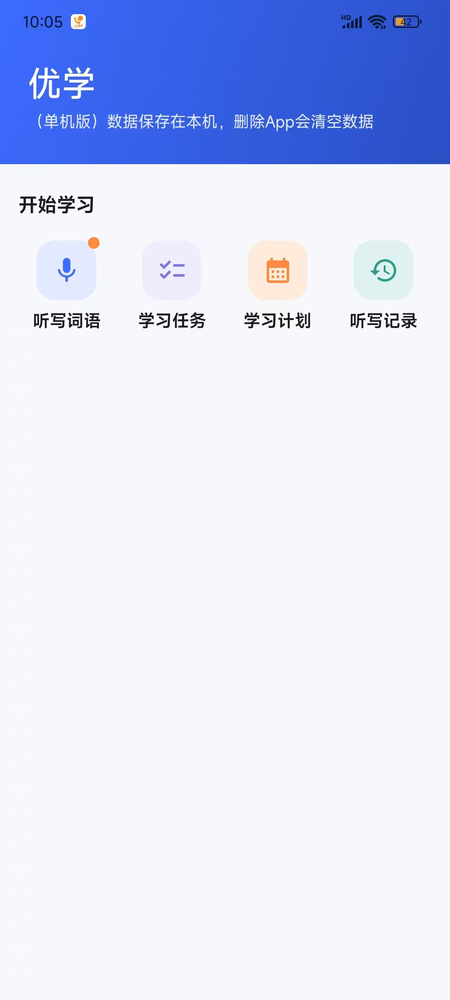
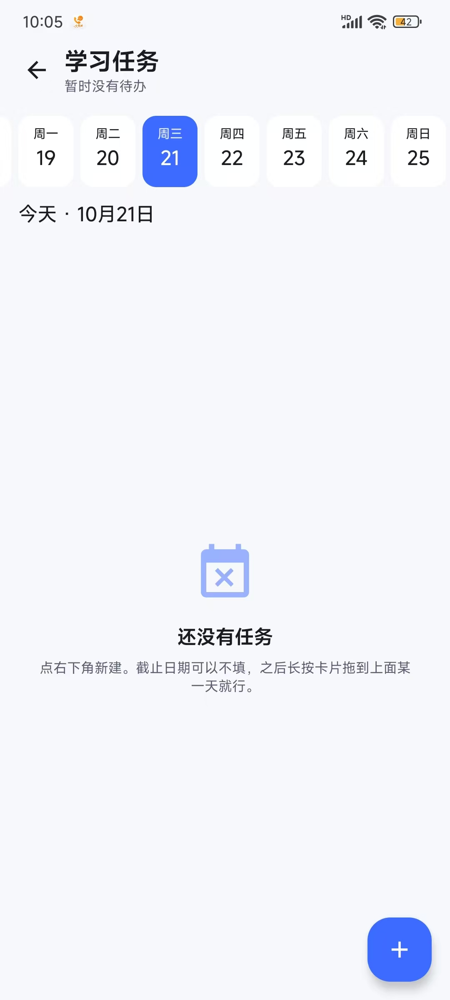
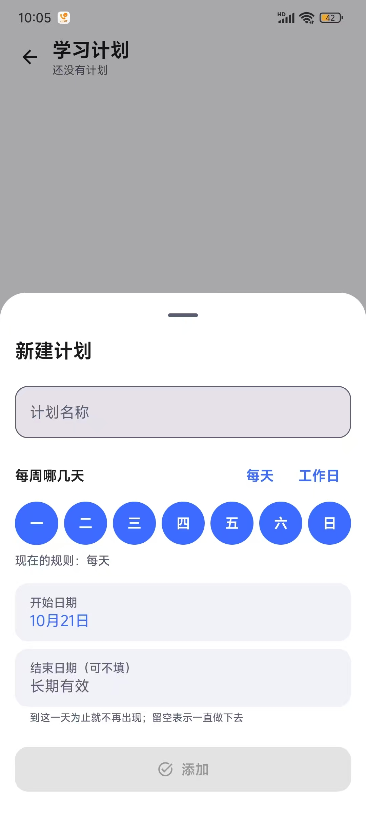

# 优学 - 学生听写词语 App

一个面向小学生的中英双语词语听写 App：家长或老师录入词表，App 逐词朗读并给出书写时间，
孩子在本子上写。**纯本地运行，不联网、不注册、不收集任何数据。**

## 项目信息

- **包名**：`cn.com.toobug.youxue`
- **开源协议**：[Apache-2.0](LICENSE)
- **应用名**：优学
- **技术栈**：Kotlin + Jetpack Compose + Material3
- **当前阶段**：纯本地版（不接入后端）
- **构建配置**：AGP 8.5.2 / Kotlin 2.0.20 / Gradle 8.9 / JDK 17 target
- **SDK**：compileSdk 35 / minSdk 24 / targetSdk 35

## 目录

- [功能](#功能)
- [截图](#截图)
- [隐私](#隐私)
- [目录结构](#目录结构)
- [环境要求](#环境要求)
- [构建](#构建)
- [设计说明](#设计说明)
- [参与贡献](#参与贡献)
- [开源协议](#开源协议)

## 功能

| 功能 | 状态 | 说明 |
|------|------|------|
| 听写词语 | 可用 | 录入词语自动朗读并计时，支持中英双语自动识别；听写中可调每字时长、跳到任意词、点一下显示当前词 |
| 拍照识字 | 可用 | 拍课本/练习册，框选后识别文字，按词拆分后逐个确认再填进听写内容 |
| 学习任务 | 可用 | 记待办并设截止日，按天查看每天要做的事，首页入口显示待办件数角标（含已过期） |
| 学习计划 | 可用 | 按周几重复的长期打卡计划，标记今日完成，月历查看连续天数与完成率 |
| 听写记录 | 可用 | 每次听写自动记下词语、时间和用时，可逐词重听，可整批复制到剪贴板 |

> 首页只摆**已经能用**的入口。规划中的功能不放进宫格做灰显占位——
> 入口页出现点不动的格子，用户的第一反应是「这 App 坏了」，不是「还没做」。

## 截图

真机截图（点开看原图）。

| 首页 | 听写录入 | 听写进行 |
|:--:|:--:|:--:|
| <a href="img/1.jpg"></a> | <a href="img/2.jpg"></a> | <a href="img/3.jpg"></a> |
| 一行四格，有待办时右上角挂数字角标 | 词表可手打、可拍照识字；实时估算书写总时长 | 顶栏可调每字时长，底部可跳词、可提前完成 |

| 学习任务 | 学习计划 | 听写记录 |
|:--:|:--:|:--:|
| <a href="img/4.jpg"></a> | <a href="img/5.jpg"></a> | <a href="img/6.jpg"></a> |
| 连续日期条，长按卡片可拖到某天（图为空态） | 按周几点选重复日，起止日期可留空 | 每次听写自动记下词语，可逐词重听、整批复制 |

## 隐私

- **不联网**：App 没有网络权限，词表、任务、计划、听写记录全部存在本机 DataStore。
- **不收集数据**：没有统计 SDK、没有崩溃上报、没有账号体系。
- **不申请多余权限**：拍照走系统相机（`ACTION_IMAGE_CAPTURE`），无需 CAMERA 权限。
- **不留云端副本**：卸载 App 即删除全部数据。

## 目录结构

```
youxue-app/
├── settings.gradle.kts
├── build.gradle.kts
├── gradle.properties
├── gradle/libs.versions.toml      # 依赖版本集中管理
├── img/                           # README 截图
└── app/
    ├── build.gradle.kts
    └── src/main/
        ├── AndroidManifest.xml
        ├── java/cn/com/toobug/youxue/
        │   ├── MainActivity.kt
        │   ├── data/              # 持久化：听写设置、任务列表、学习计划与打卡记录、听写历史
        │   ├── dictation/         # 听写核心：词语解析、间隔计算、会话状态机
        │   ├── task/              # 任务核心：分组与日期条范围（纯函数）
        │   ├── plan/              # 计划核心：重复日判定、连续打卡、月历格子（纯函数）
        │   ├── tts/               # TTS 引擎抽象与系统实现
        │   ├── util/              # 格式化、日历天换算
        │   └── ui/                # Compose 界面（首页 / 听写 / 任务 / 计划 / 记录）
        └── res/
```

## 环境要求

- JDK 17+
- Android SDK，需含 `platforms/android-35` 与 `build-tools/34.0.0+`
- 依赖均可用本地 Gradle 缓存构建（已适配离线场景）

## 构建

> 不想自己编译？到 [Releases](../../releases) 下载已签名的 APK 直接安装。

```bash
cd youxue-app
./gradlew assembleDebug
```

产物：`app/build/outputs/apk/debug/app-debug.apk`

安装包约 33MB，主要是 ML Kit 中文 OCR 的离线模型与原生库。release 构建已按 `abiFilters`
只保留 `arm64-v8a` / `armeabi-v7a`；x86 模拟器请用 debug 包。

> **Fork 后上架前，请先修改 `app/build.gradle.kts` 里的 `applicationId`。**
> `cn.com.toobug.youxue` 是本项目的发布标识，包名相同会与官方版本冲突、无法共存。

## 设计说明

### 首页：宫格入口

功能入口是一行四个的宫格（`FeatureGrid`），每个格子只有「图标 + 标题」两层信息。

- **每格只有 70dp 上下**，副标题放不下也没必要放——标题本身就是最准的说明，
  硬塞一行小字只会把标题挤到两行甚至省略号。
- **末行不足一行时用等宽空位补齐**。不补的话 `weight` 会把剩下的格子撑成双倍宽，
  图标列宽会随着功能数量变化而漂移，加一个功能前面全要挪位。
- **不用 `LazyVerticalGrid`**：入口是个位数量级，而且它嵌在 `LazyColumn` 里，
  嵌一层可滚动容器就要处理高度约束，得不偿失；`chunked` 手动分行更短更好预测。
- 草稿提示缩成图标右上角一个小圆点——宫格里挂不下「有草稿」三个字，
  而这件事只需要「提醒存在」，不需要在那里解释它是什么。

### 间隔时间算法

用户设置「每字时长」，实际间隔按词语字数动态计算：

```
间隔 = clamp(字数 × 每字时长, 最小间隔, 最大间隔)
```

例如每字 1.5s 时，`苹果`（2 字）间隔 3s，`中华人民共和国`（7 字）间隔 10.5s。
短词给足书写时间，长词不至于等待过久，且上下限可配置。

### TTS 选型

默认使用 **Android 系统 TextToSpeech**：零体积、超稳定、中英离线包在国产机型上基本预装。
`TtsEngine` 作为接口抽象，后续可平滑替换为 sherpa-onnx 等开源离线模型而无需改动业务层。

### 中英双语听写

词语按内容**自动识别语言**，用户无需手动切换：

```
汉字（CJK 表意文字）计为中文，ASCII 字母计为英文，数字与标点不计分
字母数 > 汉字数 → 英文，否则 → 中文（平局回退中文）
```

单条词语的朗读策略：

| 语言 | 序号开关开启时念 | 说明 |
|------|------------------|------|
| 中文 | `第 3 个，苹果` | 中文序号帮学生确认进度 |
| 英文 | `apple` | 只念单词，「第几个」是中文、单词是英文会夹一次语言切换，听感割裂 |

系统 TTS 在每次朗读前按检测结果切换 `Locale`，因此**中英混排的词表也能逐词读对**。
若设备缺少某种语音包，引擎进入 `PartiallyAvailable` 状态——只提示、不阻断，
并在录入页与听写页都给出明确说明（缺哪种语言、有一部分词读不出来、去哪里补装）。

### 听写进行页：三个「临时工具」

听写页的主线永远是「第几个、还剩多久、下一个」这三件事，
所以听写速度、跳转、看词都放在**不抢主线**的位置上。

#### 听写速度（每字时长）就地可调

先厘清两个容易混淆的参数——它们调的是完全不同的东西：

| 参数 | 含义 | 调它的感受 | 在哪调 |
|------|------|------------|--------|
| **每字时长** `perCharSeconds` | 每个字给几秒书写时间 | 「来不及写」→ 调大 | **听写页**顶栏 + 录入页「间隔设置」 |
| 朗读语速 `speechRate` | TTS 念得多快 | 「听不清」→ 调慢 | 录入页「朗读设置」 |

学生在听写中想改的几乎总是**前者**：等的时间不够写字。所以听写页顶栏放的是它
（显示成 `1.5 秒/字`），点开是滑块；朗读语速仍留在录入页，听写中不占位置。

生效范围比一般设置大一些——**正在等待的那个词也会跟着重新计时**：

```
拖滑块 → 已过去的时间按比例折算 → 剩余 = 新总时长 − 已过去
```

折算而不是直接换成新总量，是因为后者会让一个已经等了 10 秒的词突然又剩 20 秒，
倒计时像在倒着走。折算后拖长是「再多给一点」、拖短是「快到了」，方向一致。

实现上有个必须绕开的坑：等待循环里 `remaining` 是个**局部变量**，
外部改 `uiState.remainingMillis` 下一帧就被真实值覆盖（这个坑在「下一个」按钮上
已经踩过一次）。所以改成用**截止时刻**驱动：

```kotlin
waitDeadline = now + totalMillis          // 进入等待时记下
val remaining = waitDeadline - now        // 循环每帧重算，不是递减计数器
waitDeadline = now + 剩余                  // 调时长 = 挪动截止时刻
```

这样外部改动下一帧（≤50ms）自然生效，也没有 50ms 分片的累积误差。
暂停时 `waitDeadline` 要跟着一起往后推，否则恢复后会发现时间早就走完了。

后续的词则在 `advanceOneWord` 里**按当前设置重算**间隔，而不是用建会话时
存在 `WordRuntime` 里的快照——那是快照，改过就过期了。

改动**会存成默认**，与录入页共用同一份 `perCharSeconds`，下次进来沿用。

#### 跳到第 N 个词

底部第二排的「跳到第几个」列出全部序号，点哪个就从哪个词往下听。
序号格同时标出状态：**当前词**用蓝底、**已写过**的词用灰底、没到的用一个描边空框，
所以用户一眼能看出「跳过去是回头还是往前」。

实现上这就是「上一个」按钮的推广——两者共用 `jumpTo(index)`：

```
停朗读 → 换掉主循环 → index 之前的词标 DONE、目标及其后标 PENDING
       → runSessionFrom(target) 继续往下
```

分成两份写迟早会漏掉其中一处（比如忘了把已用时间计入 `accumulatedMillis`，
跳一次总用时就被清一次）。

注意主循环是 `for (i in startIndex until words.size)`，所以**只能往后续着走**：
跳到前面的词会从那里重新听到结尾。这与「上一个」的既有行为一致。

#### 点一下才显示当前词语

默认只给「本词 2 个字（中文）」——这是刻意保留的：把词摆在屏幕上，
听写就变成了抄写。但确实有「实在没听清、想确认一下」的场合，所以留一个出口：

| 动作 | 结果 |
|------|------|
| 点环形区域或提示行 | 展开词语原文（橙底大字，并标「点一下收起」） |
| 再点一次 | 收回 |
| **换到下一个词** | **自动收回** |

最后一条是关键：不自动收回的话，点过一次之后整套题都在裸奔。
实现放在 `LaunchedEffect(state.currentIndex)` 里，跟着当前词走。

展开态的底色与字号刻意与弱提示拉开距离，用户必须一眼看出自己正在看答案，
而不是误以为这是正常状态。

### 听写记录：只记词语

一次听写结束时自动追加一条记录，**只存那批词语**，外加完成时刻与用时：

```
1700000000000|65000|苹果|香蕉|橘子
└─ 完成时刻   └─ 用时  └─ 词语本身，变长
```

不记正确率——本 App 是家长报、学生写，没有判分环节，
硬塞一个「正确率」只能是编出来的数字。

几个决定：

- **词表放在最后、占满剩余字段。** 一次听写几个词由用户决定，字段数是变的；
  解析时按 `parts.size >= 3` 判合法，而不是像任务/计划那样要求固定字段数。
  词语逐个转义（`\` `|` `\n` `\r`），所以带竖线的词不会串到下一格。
- **写入时机在 `finish()` 里**，因此**中途放弃的听写也会被记下**。
  用户中途退出往往正是想回头看看「刚才那批词是什么」，漏记反而最可惜。
- **上限 50 条**（`DictationHistoryCodec.trim`）。历史写在同一个 Preferences 键里，
  没有分页也没有清理机制，不设上限的话这个字符串会一直长，
  而每次读设置都要把它整个解析一遍。听写记录是「回看最近练了什么」，几十条足够。
- 这一处**必须读-改-写**（`appendHistory` 里在 `edit` 块内基于当前值追加），
  与 `saveSettings` 的「整份覆盖」相反：历史是只增列表，调用方手上没有完整的那份，
  没法整份传进来。好在它不存在滑块那种高频写入场景，一次听写只写一次。

记录页（首页「听写记录」）里每条默认只显示两行词语摘要，点开才铺开全部——
一次二三十个词全展开会让列表变成一堵墙，「找上周三那次」要滑很久。
展开后每个词都能单独重听，这是家长拿手机给孩子报词时最高频的动作。

每张卡片右上角还有一个**复制**：一键把这批词全部放进剪贴板。
复制出来的是**换行分隔、不带序号**的纯词表，所以粘回听写录入框就能直接被
`WordParser` 逐行认成词表——「把上次那批词再听一遍」不用一个字一个字敲。
复制按钮常显、不放进折叠区，因为「搬去别处」这个动作不必先展开一次。

### 拍照识字：两道筛子，不是二选一

课本一页里往往混着题号、页眉、旁边那一栏、下一课的词语。识别链路里放了
**两道筛子，各管一段**：

| 筛子 | 位置 | 管什么 |
|------|------|--------|
| 裁剪 | 拍照之后 | 整块不该进 OCR 的区域 |
| 勾行 | 识别之后 | 识别出来了但不该听写的行 |

裁剪不是必须的——**框选不准时比不裁更糟**（把「苹果」框掉上半截，识别出来是残字），
所以裁剪页给了「整图识别」作为等价出口。反过来，只靠裁剪也解决不了
「识别出了多余的一行」，因为多余内容是**行**层面的问题。

> 为什么不干脆识别完直接填进文本框：OCR 一定会有错字，拍照角度、光线、
> 书页弯折都会影响结果。给一个预览页，扫一眼、划掉不要的、改掉错的，
> 比事后在文本框里逐行找出错在哪省事得多。

#### 一行可能变成多个词

横排词表在识别结果里是**一整行**，但它其实是好几个词。所以拆词放在预览页做，
每个词各占一个勾选框——拆错了用户能勾掉，符合「两道筛子」的一贯做法。

| 识别到的一行 | 结果 |
|---|---|
| `苹果 香蕉 橘子` | 三个词 |
| `苹果、香蕉、橘子` | 三个词 |
| `苹果 香 蕉` | 两个词（`香`/`蕉` 是被切碎的同一个词） |
| `小 朋 友` | 一个词（逐字识别噪声，合并） |
| `good morning` | 一个词（英文词组是一个听写单位） |
| `苹果 apple` | 一个词（中英对照条目） |

分隔点分两档：**顿号逗号**见到就断；**空格**要判断，因为它在两种形态里含义相反——
`小 朋 友` 是一个词被切碎，`苹果 香蕉` 是两个词，而这两者从字符层面长得一模一样。
判据是**被空格切出的片段长度**：全是单字符就是噪声、合并；否则断词，
并把连续的单字片段先并起来（`苹果 香 蕉` → `苹果` / `香蕉`）。

含西文的行整条不拆，但汉字之间的噪声空格仍会顺手修掉（`苹 果 apple` → `苹果 apple`）。

> 已知的取舍：`小 朋友`（噪声里夹着一个完整的词）会被判成 `小` + `朋友`。
> 这种形态区分不了，这里选了拆——残字 `小` 会被标成「只有一个字」、
> 默认不勾选，用户看得见；而合错的 `小朋友` 是**看不出痕迹**的。

#### 识别结果的行状态

清洗后每行带一个「可疑」标记，**可疑行仍然展示，只是默认不勾选**：

| 标记 | 判据 | 为什么可疑 |
|------|------|-----------|
| 像页码 | 全是数字 | 页码是 OCR 里最高频的噪音 |
| 没内容 | 全是符号 | 没有可听写的内容 |
| 只有一个字 | 去掉空白后仅 1 字符 | 多半是被切碎的残字 |
| 长句 | 超过 10 个**词元** | 多半是句子而不是词语 |

> 「词元」= 一个汉字算一个、一个西文单词也算一个。**不能按字符数算**：
> `good morning` 去掉空格是 11 个字符，按字符会被误判成句子，而它只是两个词。

程序只负责把可疑的地方指出来，**保留还是丢弃的决定权在用户**——
任何一刀切的过滤都会在某些场景下吃掉用户真正想要的内容。

#### 选型与体积

用 **ML Kit 捆绑式**（`com.google.mlkit:text-recognition-chinese`）：

- **不用非捆绑式**（`play-services-mlkit-*`）：那个只有 0.3MB，但模型要从
  Google Play 服务下载——国内机型基本没有 GMS，等于功能不可用
- **用中文包而不是拉丁包**：中文包的 assets 里同时带 `Hani_ctc` 和 `Latn_ctc`
  两套模型，**一个依赖就覆盖中英**
- **不用 Tesseract**：中文准确率明显更低，拍照倾斜/光影下更差

代价是体积。原生库 `libmlkit_google_ocr_pipeline.so` 四个 ABI 合计 41MB：

```
arm64-v8a 11.1MB / armeabi-v7a 6.8MB / x86 11.6MB / x86_64 11.6MB
```

所以 `release` 用 `abiFilters` 只保留 arm 两种（真机覆盖率足够，x86 系列纯粹给模拟器）。
`debug` 不设限，Android Studio 的模拟器上也能跑。

#### 三个容易踩的坑

1. **大图必须降采样。** 手机随手拍 4000×3000，ARGB_8888 直接解码是 48MB，
   几台机器上就会 OOM，而且是在拍照回来那一刻才崩。统一用
   `inJustDecodeBounds` + `inSampleSize` 压到长边 2000——ML Kit 的检测网络
   本身就在这个量级工作，喂更大的图只是更慢更费内存。
2. **EXIF 方向不处理，OCR 会拿到一张躺着的图。** 竖拍的后置摄像头照片
   像素是横躺的，靠 EXIF 标记提醒看图的人转 90 度，识别率断崖式下跌。
   用框架自带的 `android.media.ExifInterface`（minSdk 24 的流构造函数够用），
   **不为这一件事加新依赖**。
3. **取 `lines` 不取 `getText()`。** 后者是整页拼成的一个大字符串，粒度太粗，
   和「一行一个词语」的约定对不上。行顺序 ML Kit 已按阅读顺序给好，
   不要再自己按坐标排——多栏、横排竖排的版面分析交给引擎。

### 学习任务：日期是「截止日」，任务是一段区间

交互模型的核心是：「日期非必填」与「拖动绑定」其实是同一件事的两面——
正因为可以先不填日期，拖动才有意义。所以列表里必须有个**未安排**的归属地，
否则任务一拖出去就没地方放。

日期字段的含义是**截止日**。加上创建那天，一条任务就是一段区间：

```
区间      ：开始日（创建那天）──────────→ 截止日（拖到／选到的那天）
日期条角标：区间内每一天都亮，做完才熄
列表内容  ：由「选中的那一天」决定，点日期条就换一套
```

选中某一天时，列表分成四组：

```
已过期 → 要做 → 未安排 → 这天完成
```

- **已过期**：截止日在选中日之前且没做完。刻意**不隐藏**——不管切到哪一天都看得见，
  否则一次漏做就再也找不回来了。
- **要做**：选中日落在区间内。按截止日升序排，同截止日再按创建时间。
- **未安排**：没有日期的任务。**不随日期切换消失**，因为它是拖拽的来源，
  跟着日期藏起来就没法把它拖到别的日期上了。
- **这天完成**：选中日那天完成的。既给「今天做完了什么」一个交代，
  也留一个勾错之后的撤销入口。

几个刻意的取舍：

- **开始日不让用户填**，取创建那天（若截止日更早则取截止日本身）。
  否则新建的任务会在它还不存在的那些日子里亮起角标。取较小值是为了守住
  `开始日 <= 截止日` —— 区间一旦为空，任务在列表里**哪一天都不会出现**，
  等于把它弄丢了。这条规则只写在 `TaskItem.reschedule` 里，
  拖动落点和编辑弹层共用同一份逻辑。
- **日期条是连续的**，不是「只画有任务的那几天」。否则相邻两格可能相差一个月，
  看上去却是挨着的，会误导人。已有任务若落在默认区间外，会把区间撑开（上限 180 天）。
- **已完成的任务不参与角标、也不撑开日期条**，否则用久了日期条会被历史任务越拉越长。
- **日期存 epoch day 而不是时间戳**。「任务安排在哪一天」是日历概念而非时刻概念，
  存时间戳会引入时区与夏令时问题——同一条任务在不同时区回看可能落到前后一天。
  但「完成时刻」相反：它是真实时刻（毫秒），同一天内能分出先后，
  按天归组时再用 `DayMath.localDayOf()` 换回日历天。
- 换算只用 `java.util.Calendar`，不用 `java.time`：后者需要 API 26 或开启
  core library desugaring，而 minSdk 是 24。

#### 两个角标，口径刻意不同

同一条任务会在两处变成角标，**数字可以不一样，这是有意的**：

| 角标 | 位置 | 数什么 | 为什么 |
|------|------|--------|--------|
| `TaskGrouper.dayCounts` | 任务页日期条某一格 | 当天落在 `开始日..截止日` 内且未完成 | 过期的任务**不是「今天要做」**，点亮今天那格会是假话 |
| `TaskGrouper.pendingCount` | 首页「学习任务」入口 | **已过期 + 今天要做** | 入口角标回答的是「我这儿还有没有活」，今天没有新安排、却欠着昨天的三条，也必须亮 |

入口角标判据写成「已过期 ∪ 今天要做」而不是等价的 `startDay <= day`，
是为了让它**恒等于任务页上那两组之和**——点进去数的条数必须和首页看到的一致
（有单测钉住这条契约）。未安排的任务两处都不算：没有日期，谈不上「该完成」。

代价是：一条过期任务只要不完成也不改期，角标就一直亮着。
这是刻意的——它确实还欠着，而清掉它的动作（做完 or 拖到新日期）本来就在任务页里。

两个角标的数字来源都在 `HomeViewModel`，通过订阅存储拿到而不是进页面读一次：
**改动发生在任务页/计划页，首页只能在流上读**，否则勾掉一条返回首页角标不消失。

#### 拖放是手写的

Compose 没有现成的跨区域拖放组件，实现要点：

| 环节 | 做法 |
|------|------|
| 起拖 | `detectDragGesturesAfterLongPress`，长按超时后才接管，轻扫仍是列表滚动 |
| 命中检测 | 每个日期格用 `onGloballyPositioned` 上报自身在根坐标系的 `Rect`，按点包含判断 |
| 浮层 | 拖动的卡片单独画在页面级 `Box` 的最上层，用 `IntOffset` 定位 |
| 原位 | 保留原布局、只把卡片绘制隐藏（`graphicsLayer { alpha = 0f }`） |

两个容易踩的点：

1. **重组范围要收紧。** `drag.visual` 是 Compose 状态，任何读取它的作用域都会在拖动时重组。
   若在页面级读，拖一张卡会让整个列表每帧重组。所以浮层抽成独立组件，
   卡片和日期格各自用 `derivedStateOf` 把「是否与我有关」这个布尔值挡了一层。
2. **命中检测用实际边界，不要用「序号 × 格宽」算偏移**——后者在横向滚动、
   间距调整后会失准。

#### 存储：不引入新依赖

任务列表用 `TaskCodec` 编成「一行一条、字段用 `|` 分隔」的文本存进独立的 DataStore
（`youxue_tasks`，与听写设置分开，避免改一个任务就连带重写设置）。

不用 JSON 的原因：`kotlinx-serialization` 需要一个额外的编译器插件（项目依赖目录里没有），
而 Android 自带的 `org.json` 在 JVM 单测里是空实现、没法验证。
自定义格式零依赖、纯 Kotlin，能被单测完整覆盖。文本字段里的 `|`、换行、反斜杠都会转义，
所以任何用户输入都能安全往返；解码对坏数据宽容——解析失败的行直接丢弃，
宁可少一条任务，也不能让整个列表打不开。

> 等以后做词库和历史记录时，建议统一换成正经历格式，只迁移一次。

### 学习计划：重复规则与打卡记录

计划是**周期性的**（「每周一三五听写」），任务是一段**区间**（「周五之前做完」）——
两者语义不同，所以计划没有做进 `TaskItem`，而是独立的 `StudyPlan` + `PlanRecord`，
存在自己的 DataStore（`youxue_plans`）里。

按之前定下的方向，**计划和听写内容不打通**：计划本身不携带词语，
它只是「该练了」的提醒和「练过了」的记录。这样改听写流程不会波及计划。

#### 重复规则

`weekdays: Set<Int>` 里的 0..6 是**星期**（0 = 周日，与 `DayMath.dayOfWeek` 一致）。
**空集合表示「每天」**，不另设一个「每天」开关——

- 用「空集 = 全部」而不是「空集 = 无」。反过来会让「新建计划忘了勾周几」
  变成一条永不触发的死计划，用户还找不到原因。
- 「每天」「工作日」「周末」都是快捷按钮，点完落到同一份 `weekdays` 上，
  不存一个额外的模式字段。**一份状态只有一种表达**，否则「模式 = 每天 但 weekdays 是空的」
  这种不一致迟早会出现。

`startDay` / `endDay` 都是 epoch day，`endDay == null` 表示长期有效。

#### 连续天数只按「重复日」算

`PlanSchedule.streak` 数的是**连续的重复日**，中间的非重复日直接跳过：

```
计划：周一、周三、周五
周一打卡 ✓  周二（不重复，跳过）  周三打卡 ✓  周五未打卡
→ 今天（周日）看：连续 2 天（周一、周三），不是「周三断了」
```

否则一个「每周一次」的计划永远显示连续 1 天，这个数字就没意义了。

顺带一个刻意的口径：**如果今天是重复日但还没打卡，连续天数从上一个重复日往前数**，
不立即归零。早上打开 App 看到「连续 0 天」会让人以为昨天白做了——
实际上今天还没到该判定的时刻。

#### 只提示、只提醒，不做系统通知

今天有待做计划时，首页宫格那个入口右上角挂一个**红色数字角标**。

不做通知的原因和听写里不弹窗是一个道理：通知要申请权限、要跟各家
ROM 的后台省电策略斗智斗勇，属于「投入大、结果不可控」的功能。
角标已经能回答用户唯一关心的问题——「今天还有没有要做的」。

#### 列表和详情共用一个 ViewModel

计划列表和详情是两个路由，而 `viewModel()` 默认作用域是当前
`NavBackStackEntry`，**两个路由就是两个实例**。如果各拿各的，
详情页打卡之后返回列表，列表还是刚进页面时读到的那份快照。

所以详情页不取自己的 entry，而是取 `Routes.PLANS` 那个 entry 当 owner：

```kotlin
// MainActivity.kt，详情路由内部
val parent = remember(entry) { navController.getBackStackEntry(Routes.PLANS) }
PlanDetailScreen(..., viewModel = planViewModel(parent))
```

`viewModel()` 按 owner + key 缓存实例，所以这次取到的就是列表页那一个。
计划页与详情页始终成对出现，那个 entry 一定还在栈上。

打卡本身是**幂等**的：`toggleToday` 对同一天重复调用只在「有记录 / 无记录」之间翻转，
不会叠出第二条记录（模型的不变量是**一个计划一天最多一条记录**）。

#### 不用 `Calendar` 画月历

月历用 `DayMath.monthGrid(year, month)` 生成**固定 42 格**（6 行 × 7 列，周日起）：

- **固定 42 格而不是「这月有几天就画几格」**：行数一变，`LazyVerticalGrid` 的
  高度约束和滚动位置都会跳；月份切换时格子数量跟着变，视觉上会抖。
  多出来的格子画上个月/下个月的日期（弱化显示），顺便给了「跨月连着看」的余地。
- **今天是圈、已完成是绿底、该做没做是灰底**，三种状态互不叠加：
  今天已打卡就走绿底 + 圈，颜色优先于圈。
- **完成率只统计「已经过去且在重复规则内的日子」**，未来的重复日不计入分母，
  否则一个刚建的计划完成率会被还没到的日子稀释成个位数。

## 参与贡献

欢迎提 Issue 和 PR。提交前请确认：

- 纯逻辑（词语解析、间隔计算、日期换算、分组统计）写成不依赖 Android 的纯函数，并补单元测试
- 提交前跑一遍 `./gradlew testDebugUnitTest`
- 代码风格跟随现有文件：注释解释**为什么**这么做，而不是复述这行代码做了什么

## 开源协议

本项目采用 [Apache License 2.0](LICENSE)，版权归 toobug 所有。
第三方组件的许可信息见 [NOTICE](NOTICE)。

应用名「优学」与应用图标不在代码许可范围内，fork 后请自行替换。

